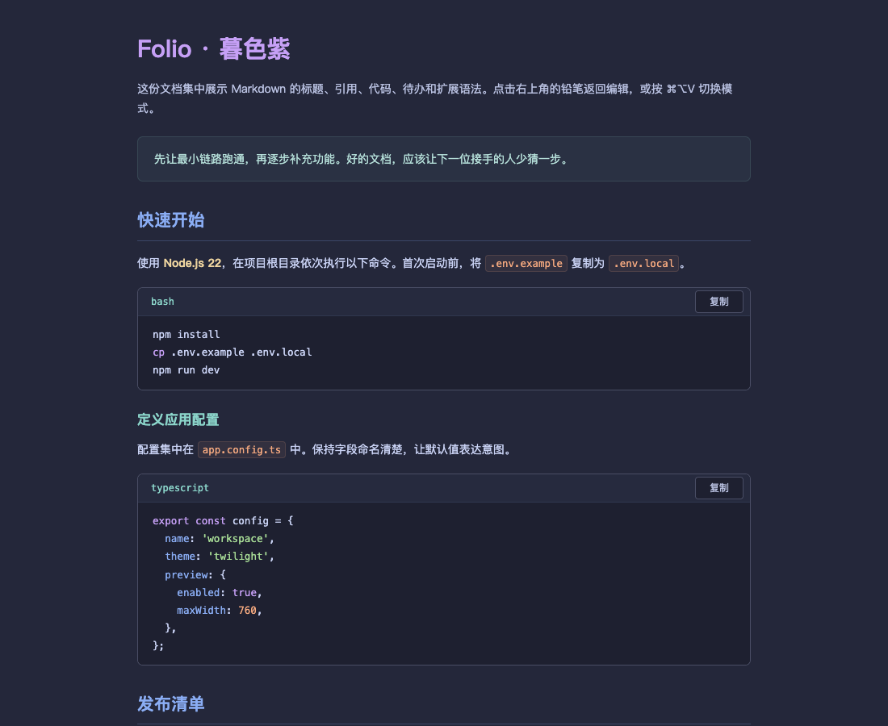
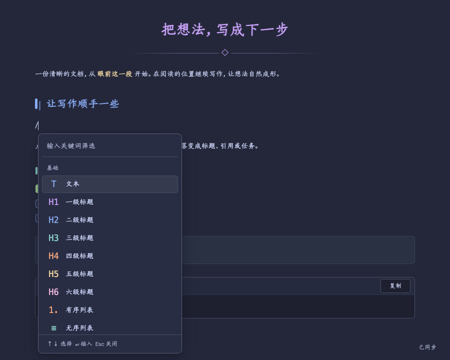

<p align="center">
  
</p>

<h1 align="center">Folio</h1>

<p align="center">在 Markdown 预览里，直接写。</p>

<p align="center">
  <a href="#安装与打开">安装</a> · <a href="#按章节阅读">阅读</a> · <a href="#在预览里写作">写作</a> · <a href="#重复内容用模板开始">模板</a> · <a href="#用列表整理思路">多级列表</a> · <a href="./examples/preview.md">语法样本</a>
</p>

Folio 是面向 **Cursor** 的 Markdown 编辑预览扩展。暮色背景、彩色标题和清楚的列表层级，让文档更容易读；点击内容即可继续写，修改仍保存在原来的 Markdown 文件中。

<p align="center">
  
</p>

## 安装与打开

使用 **Node.js 22**，在本地生成安装包：

```sh
git clone https://github.com/msunx/vscode-extension-markdown.git
cd vscode-extension-markdown
npm ci
npm run check
npm run package
```

1. 在 Cursor 命令面板执行 **Extensions: Install from VSIX**，选择 `folio-markdown-0.20.1.vsix`。
2. 执行 **Developer: Reload Window**，打开任意 Markdown 文件。
3. 点击右上角的**书本按钮**「Folio 编辑预览」。点击**铅笔按钮**返回源码，也可用 `⌘⌥V` 切换。

首次启用时，Folio 会固定这两个标题栏按钮。如果曾手动隐藏，可在命令面板搜索 `Folio`。

通过铅笔按钮或 `⌘⌥V` 返回源码后，再次进入同一分栏的预览会复用已有页面，并同步源码修改。关闭预览标签后重新打开，需要等待 Cursor 创建新的预览容器；包含大量 Todo 的文档已减少重复扫描，缩短内容初始化时间。

## 按章节阅读

标题左侧的箭头可折叠或展开本节内容，范围到下一个同级或更高级标题之前。子章节可以独立折叠，收起再展开父章节时保留子章节状态。

独立成段的图片默认居中，行内图片跟随文字排列。点击正文中的图片可放大查看，支持切换原始尺寸查看细节。点击背景、右上角关闭按钮或按 `Esc` 返回原位置；键盘聚焦图片后可按 `Enter` 或空格打开。

独占一段的 HTTPS 视频直链（MP4、M4V、WebM、OGV）会显示为视频预览，点击播放按钮即可在页面内播放，支持暂停、进度和全屏。滚动到附近时才加载首帧，不自动播放；无法播放时可重试或打开原视频。鼠标移入视频后，右上角显示打开原视频的图标，键盘聚焦时也会显示。行内链接、普通引用和代码中的链接保持原样，原 Markdown 无需改写。

左侧悬浮目录采用无边框列表，按标题层级缩进、配色并高亮当前位置。点击标题跳转；点击标题前的箭头，只收起或展开子目录，不改变正文折叠。收起再展开父目录会保留子目录状态，左上角仍只有显示／隐藏开关。

目录内不显示滚动条，滚轮、触控板和键盘仍可滚动。标题保持单行，超长部分用省略号隐藏；悬停或键盘聚焦时，标题在原行平滑向右展开，极长标题会在行内缓慢横移。开启系统“减少动态效果”时取消动画，展开后可横向滚动查看。

新增、改名、删除或转换标题会实时更新目录，包括尚在同一编辑块内的连续输入。方向键上下选择、左右收起／展开分支，`Enter` 跳转、`Esc` 收起目录。

正文始终在预览区域居中，目录显示／隐藏不会改变正文的位置和宽度。宽窗口默认展开目录，空间不足时采用悬浮目录并收成左上角按钮，打开后点击标题、页面空白处或按 `Esc` 收起。没有标题的文档不显示目录。折叠和目录状态在当前工作区按文件记忆，关闭再打开后恢复；它们不修改 Markdown 内容，也不占用文档撤销记录。

## 在预览里写作

点击标题、正文、列表、引用或表格单元格即可编辑。正文、标题、引用和列表在行首按 `Backspace` 可向前合并，按住可连续删除；保留文字样式、任务状态与撤销重做。在空行输入 `/` 或 `、`，选择标题、列表、任务、代码、引用、分隔线、链接、项目文件、Emoji 表情、模板、图片或表格；继续输入 `/h2`、`、任务` 等关键词筛选。

<p align="center">
  
</p>

| 操作 | macOS 快捷键 |
| --- | --- |
| 切换视图 | `⌘⌥V` |
| 模块菜单 | `⌘/` |
| 选择 / 插入 | `↑`、`↓` / `Enter` |
| 结束编辑 | `Esc` |
| 缩进 / 退级 | `Tab` / `Shift+Tab` |
| 撤销 / 重做 | `⌘Z` / `⌘⇧Z` |
| 保存 | `⌘S` |
| 定位源码 | `Option` + 双击内容 |

Windows / Linux 对应使用 `Ctrl+Alt+V` 切换、`Ctrl+/` 打开菜单、`Ctrl+S` 保存、`Alt` + 双击定位源码；撤销和重做使用编辑器默认快捷键。其他按键相同。

点击文档末尾的空白区域即可另起正文，支持继续输入或使用 `/`、`、` 插入模块；重复点击不会创建多个空段落，仅点击而不输入不会改写文件。

在正文段落开头输入 `-` 再按空格，会自动转换为无序列表；输入数字再按空格会转换为有序列表，例如 `3 ` 从第 3 项开始，也兼容 `1. ` 的写法。转换后可直接输入，`Enter` 继续下一项，空列表项再次 `Enter` 返回正文，支持撤销和重做。行内文字、现有列表、代码和表格中的输入保持原样。

普通编辑直接同步到文档，保存沿用编辑器的自动保存设置；撤销和重做在预览中直接执行。代码块右上角还可一键复制代码。

在预览中放置光标后，按 `⌘V`（Windows / Linux：`Ctrl+V`）粘贴文字，也可替换选中文字。正文、列表和表格中的多行文字保留换行，Todo 保留勾选框和层级，表格保留行列结构。

在空白正文段落粘贴包含标题、列表、引用、代码块、表格等语法的 Markdown，会显示为对应模块，并在后面留下继续输入的位置；支持撤销、重做和保存。已有文字、列表或单元格中的粘贴按文字处理，代码编辑框保留原始内容。

**行首选模块，行内按快捷键。** `/` 和 `、` 只在行首触发模块菜单，正文中的顿号和斜杠照常输入。在已有文字中把光标放到插入位置，按 `⌘/`（Windows / Linux：`Ctrl+/`），只显示「链接」「项目文件」「Emoji 表情」；保留前后文字和格式，插入后继续输入正文。空行仍提供标题、列表、分隔线等完整模块。

### 设置选中文字的样式

在同一段正文、标题、高亮块、列表项、Todo 或表格单元格内选中文字，会显示浮动工具条。可设置 **加粗**、*斜体*、下划线、删除线、`行内代码`、文字颜色和背景色；再次点击已启用的样式可取消，**清除格式**恢复普通文字并保留链接。

点击按钮后保留选区，可连续设置多种样式。颜色面板提供与暮色背景协调的八种配色；背景选择「无背景」可单独移除底色。选中文字后，`⌘B` 加粗、`⌘I` 斜体、`⌘E` 转换或取消行内代码，Windows / Linux 使用 `Ctrl`。`Alt+F10` 聚焦工具条，方向键选择，`Enter` 应用，`Esc` 关闭。

支持撤销、重做与保存。加粗、斜体、删除线和行内代码优先保存为 Markdown；颜色、背景色、下划线，以及 Markdown 分隔符无法准确表达的标点边界使用受限的行内 HTML。其他阅读器若过滤 HTML 样式，配色可能不显示。跨段落选区和源码编辑框不显示该工具条。

### 引用：保留原文

普通引用使用独立的引用配色，内容按纯文本展示，保留换行与空行。`#`、`===`、列表标记、加粗、链接、图片、HTML 和代码围栏均按原文显示，不再解析为其他格式。可直接输入、粘贴与保存；引用内不启用文字样式和列表自动转换，模块菜单仅提供 Emoji 表情。

这是 Folio 的展示规则，源文件仍使用 Markdown 的 `>` 引用语法；其他 Markdown 阅读器可能继续解析引用内的格式。高亮块与 `[!NOTE]` 等提示块保留各自的展示规则。

### 文件属性：记录时间与来源

文件属性显示在右侧无边框悬浮栏中，以两列展示名称与内容。点击右上角属性图标展开或收起，正文位置与宽度始终不变。宽窗口默认展开已有属性，窄窗口以浮层打开；栏内可独立滚动，收起后仍保留未保存的修改。创建时间显示为易读日期，来源链接显示网站名，旁边的箭头用于打开来源。

点击属性内容即可原位编辑，聚焦时显示输入框；失焦或按 `Enter` 结束当前字段的编辑，文本中按 `Shift+Enter` 换行，文本列表每行一项。点击左侧属性名打开菜单，可重命名自定义属性、切换文本／数字／是或否／文本列表类型，或删除属性。

尚无属性时，点击右上角 **添加文件属性** 图标开始；创建时间优先预填本地文件的创建时间，可以修改或清空。打开预览不会自动写入。

属性通过 YAML front matter 与 Markdown 保存在同一个文件中：

```yaml
---
created: "2026-10-27T12:30:00+08:00"
source: https://example.com/reference
tags:
  - 视频
  - 笔记
---

# 正文
```

修改后才显示 **保存属性** 和 **取消**。保存只更新文件顶部，保留正文；修改可通过编辑器撤销、重做。取消恢复已保存的值，来源链接在收起状态下仍可点击。`Esc` 先关闭当前属性菜单或结束字段编辑，再按一次收起属性区；收起保留草稿。`⌘S` / `Ctrl+S` 可直接保存属性。

已有注释、未知字段和复杂嵌套数据会保留；复杂对象、别名等属性在面板中只读，通过 **查看源码** 编辑。YAML 语法错误、重复名称、无效链接会就近提示；保存失败或属性被其他编辑修改时保留当前输入，使用 **重新读取** 获取最新属性后再编辑。来源链接接受 HTTP／HTTPS；创建时间接受 `YYYY-MM-DD` 或包含时间的 ISO 日期。

### 高亮块：用表情标记重点

在独立正文或标题行首输入 `/高亮`、`/callout` 或 `、高亮`，选择 **高亮块**。淡紫底色与左侧强调线区分重点内容，行首自动显示 🌈；正文直接编辑，支持多段文字与行内样式。

点击左侧表情打开选择框，可搜索、切换分类或用方向键选择，回车确认更换，`Esc` 取消。更换只影响图标，不改正文；支持撤销、重做与保存。末尾空段落再按 `Enter`，即可退出高亮块继续正文。拖动手柄将整个高亮块视为一块，支持移动和删除。

高亮块以 `> [!CALLOUT] 🌈` 加引用正文保存，重新打开后保留内容与表情；未输入文字的空块也能继续编辑。该样式是 Folio 扩展，其他 Markdown 阅读器会按普通引用显示，并可能保留标记文字。

### 代码块：语言、换行与就地编辑

代码块左上角可搜索并切换语言，内置 JavaScript、TypeScript、Java、Python、Go、Rust、SQL 等语法高亮；未知语言保持纯文本，不改写代码。选择「纯文本」可取消高亮。

长代码**默认自动换行**。标题栏的「换行」控制本页代码块的显示方式，关闭后可横向滚动；显示换行不会给文件增加换行字符。点击「编辑」或代码正文即可修改代码内容，围栏由 Folio 维护；点击「完成」或 `Esc` 回到高亮阅读。代码编辑时 `Tab` 输入两个空格，`Shift+Tab` 移除行首缩进。复制只包含代码正文。

语言与代码内容沿用文档的保存、撤销和重做，支持保存后重新打开。

### 从项目选择图片

在独立正文或标题行首输入 `/image`、`/图片` 或 `、图片`，选择**图片**，打开当前文档所属项目的图片选择框。按名称或路径搜索，点击缩略图预览，可填写图片说明，再点击 **插入图片**。`Esc` 取消并回到原位置，`⌘Enter` / `Ctrl+Enter` 插入已选图片。

范围限于本项目，支持 PNG、JPEG、GIF、WebP、SVG、AVIF、BMP 和 ICO；排除 `.git`、`node_modules`、`files.exclude` 中明确排除的内容，以及指向项目外的符号链接。图片仍保留在项目原位置，文档使用普通 Markdown 相对路径，不复制或上传图片。

鼠标移到独立图片块上，可**更换图片**或**删除**，删除支持撤销。损坏、已删除或无权读取的图片会显示提示；新增图片后点击「刷新」即可重新读取。文档需先保存在已打开的项目中。

### 拖动与操作内容块

鼠标移到内容上，左侧会出现「类型图标＋六点手柄」。按住手柄拖动，蓝色插入线提示落点，松开完成移动；拖动时靠近页面上下边缘可自动滚动，`Esc` 取消。

- Todo 按单条移动，带子级的任务连同子级一起移动；拖到其他任务旁时采用目标层级。
- 正文按 Markdown 逻辑行、标题按一个标题移动；屏幕自动折行不会拆块，含跨行行内格式的段落整体移动以保留语法。
- 普通有序／无序列表、表格、代码块和引用按整体移动。

点击同一个手柄可打开块操作菜单，选择 **删除** 移除当前块；删除范围与拖动一致，父任务包含其子级。菜单支持 `Esc` 或点击外部关闭，聚焦手柄后可按 `Enter` / 空格打开。

点击手柄即可直接选择目标格式：**删除**置顶，下方以分隔线隔开所有适用格式，无需进入二级菜单。当前格式以勾号标记；方向键选择、`Enter` 应用，`Esc` 关闭菜单。

- 正文、单行 H1–H6 标题、简单引用和单行代码可切换为正文、标题、引用、代码块、普通列表或任务列表；多行内容只提供适合其结构的选项，不合并成一行。
- 普通有序／无序列表与任务列表可互转。普通列表转换当前层级的所有项目，顶层 Todo 转换当前一项；子级 Todo 暂不提供转换，子列表的内容、类型和完成状态保留。转为有序列表从 1 编号，转为任务列表时保留已有任务状态，新任务默认为未完成。
- 转为代码块时保留块内 Markdown 原文；转出代码时按文字保留，避免代码中的标题、链接或 HTML 被意外解析。代码语言可通过代码块左上角另行选择。
- 表格、图片、分隔线等不提供格式转换。引用转为正文或代码时保留文字，避免其中的 Markdown 符号意外生效。

转换前会同步正在编辑的内容，保留前后段落；转换支持撤销、重做、保存和重新打开。

移动保留原始 Markdown、勾选状态、链接及表格列宽；移动和删除均支持撤销、重做和保存。

### 直接编辑表格

点击普通 Markdown 表格的单元格直接输入。鼠标移入表格时，上方和左侧显示较宽的控制边框，分别对应列和行。

- 点击一段边框，选中整列或整行，再点击浮出的删除按钮；也可按 `Backspace` / `Delete` 删除。
- 行列之间和末尾的圆点，悬停时显示「＋」及插入位置引导线，点击即可在该位置添加行或列。
- 表头可以直接编辑，表头行和最后一列会保留；宽表格横向滚动时，控制边框与插入点随单元格对齐。

鼠标移到列间分隔线时，会显示蓝色引导线和左右调整光标。按住拖动即可调整相邻两列的宽度，拖动最右侧边缘可调整表格总宽度；最小列宽为 90px。松开鼠标完成调整，`Esc` 取消，`⌘Z` / `Ctrl+Z` 撤销。键盘聚焦分隔线后也可用左右方向键调整，按住 `Shift` 每次微调 1px。

列宽随文档保存，重新打开后保留，增删列时同步维护。Folio 用表格前的隐藏 HTML 注释保存列宽，表格正文仍是标准 Markdown；其他 Markdown 阅读器一般忽略该注释，按自身规则排版。

`Tab` / `Shift+Tab` 切换单元格，`Enter` 移至下一行，走到表格末尾时自动添加一行；`Shift+Enter` 在单元格内换行。输入 `/table` 或 `/表格` 创建的表格也可直接编辑。

修改同步为 Markdown，保留未编辑单元格的格式与列对齐；支持 `⌘Z` 撤销、`⌘⇧Z` 重做和 `⌘S` 保存。单元格中用 `⌘/` 可插入链接、项目文件或 Emoji。

### 插入 Emoji 表情

在正文、标题、引用或列表的光标位置按 `⌘/`，选择 **Emoji 表情**；空行也可输入 `/emoji` 或 `、表情`。在选择框中按分类浏览，或用中文、英文关键词搜索，例如「开心」「咖啡」「rocket」。点击表情即可插入；也可用方向键选择，按 `Enter` 插入，按 `Esc` 取消并回到原位置。

支持在句子中间插入或替换选中文字，保留前后内容和格式；插入后可继续输入、撤销、重做和保存。表情以普通 Unicode 字符写入 Markdown，无需联网加载图片，具体外观随系统 Emoji 字体显示。

### 链接到项目文件

输入 `/文件` 或 `/file`，选择**项目文件**，在弹出的选择框中按文件名或路径搜索，按 `Enter` 插入链接，按 `Esc` 取消。也可通过 `、` 或 `⌘/` 打开模块菜单选择。

链接显示文件名，保存为相对于当前 Markdown 的路径，支持中文、空格、括号等文件名。点击 Markdown 文件链接会进入 Folio 预览；其他文件在 Cursor 中打开，不再额外打开浏览器资源页面。链接沿用普通编辑的保存、撤销和重做。

文档需要先保存在已打开的项目文件夹中。选择范围为当前文档所在项目，多根工作区按所属文件夹区分；过滤 `.git`、`node_modules` 以及 `files.exclude` 中明确启用的排除项。

## 重复内容，用模板开始

日记、会议记录、复盘等固定结构，可以保存为模板，写作时直接插入。模板库内置「日记」，左侧按名称搜索和选择，右侧查看插入效果。

1. 在独立正文或标题的行首输入 `、模板`（或 `/模板`），选择 **模板**。
2. 选择已有模板；或点击 **新建模板**，填写名称和 Markdown 内容，再点击 **保存模板**。
3. 查看预览后点击 **插入模板**。内容插入当前位置，前后文字保留，光标留在模板后方，可继续写作。

例如，新建一个自己的日记模板：

```markdown
# {{date}}

{{weekday}} · 日记

## 正文

写下今天想记住的事。

## 明日计划

- [ ] 一件想做的事
```

| 变量 | 插入时替换为 |
| --- | --- |
| `{{date}}` | 电脑本地日期，格式为 `YYYY-MM-DD` |
| `{{weekday}}` | 当天星期，例如 `星期六` |

编辑模板时，可点击 **当天日期**、**星期** 按钮插入变量。日期标题仍遵循 Folio 的「今天」显示规则，Markdown 中保存真实日期。

自定义模板支持 **编辑、另存为、删除**；内置日记通过 **另存为** 创建自己的版本。修改或删除模板不会改变已插入的文档。模板编辑表单中按 `⌘S`（Windows / Linux：`Ctrl+S`）保存模板，回到正文后恢复文档保存。

模板保存在**本机 Cursor 的扩展存储**中，可跨项目使用，不会向项目增加配置文件，也不会随项目 Git 仓库同步到其他电脑。返回或关闭模板库会保留未保存的表单输入，在本次预览中可点击 **继续未保存的模板** 恢复；保存失败时输入仍保留，可重试。

模板作为独立模块使用，列表、表格及行内菜单不提供此入口。取消选择不会插入内容；插入支持撤销、重做和保存。

## 用列表整理思路

列表项之间留有空行、包含多个段落或嵌套任务时，点击文字仍保持可视化编辑，不会因为空行切换成整段 Markdown 源码。

**在列表文字中按 `Tab`，当前项连同子项成为前一项的子列表；`Shift+Tab` 退一级。** 无序、有序、混合列表和 Todo 都适用，选中连续同级项可以一起调整。

<p align="center">
  
</p>

列表项末尾按 `Enter` 新建同级项；在空项上再按 `Enter`，退出列表并开始普通正文。从列表中间退出时，新正文位于前后列表之间，有序列表后半段继续原编号。已有内容和子项层级保持不变，新建 Todo 默认未完成。Todo 文字删空后，再按 `Backspace` 删除空项；光标回到前一项，没有同级前项时回到父项。

同级第一项没有可归属的前项，顶层也不能再退级，这两种情况保持原位。按 `Esc` 结束编辑后，`Tab` 恢复焦点导航。

点击 Todo 复选框，`[ ]` / `[x]` 会同步写回原文；点击任务文字可以继续编辑。复选框支持键盘聚焦和空格切换，保存、撤销、重做与普通编辑一致。

**右键点击勾选框**，可选择「待办 / 进行中 / 已完成」。进行中的任务显示为暖金色文字和横杠勾选框；普通点击仍完成或取消完成，`Shift`＋点击可轮换三种状态。键盘聚焦勾选框后，`Shift+F10` 打开菜单，方向键选择、回车确认；`Shift+Space` 可直接轮换。

三种状态分别保存为 `[ ]`、`[/]`、`[x]`，关闭后重新打开仍保留。`[/]` 是 Folio 的扩展任务语法，其他 Markdown 预览器可能按普通列表文字显示。

空 Todo 关闭预览后重新打开，仍可点击勾选框右侧继续输入，或按 `Backspace` 删除空项。

## 让颜色和字体帮助阅读

- **标题有层次。** H1–H6 分别使用淡紫、蓝、青绿、桃、浅金和粉色。一级标题居中，配有细线与菱形；其他层级用短条、圆点、圆环等标记区分。
- **当天日期一眼可见。** 一级标题内容为 `YYYY-MM-DD` 且等于电脑本地日期时，显示「今天」；鼠标悬停或进入编辑时恢复真实日期。跨天自动更新，Markdown 原文、复制内容和标题锚点保留日期。
- **列表有线索。** 前六级以蓝、青绿、桃、紫、粉、金色标记和圆角连接线呈现，更深层级沿用金色，正文保持统一颜色。
- **字体只作用于预览。** 标题、正文与模块菜单优先使用本机安装的仓耳今楷，兼容仓耳今楷05的中英文名称。没有安装时回退到当前 `editor.fontFamily`；代码和原始 Markdown 编辑框始终沿用编辑器字体。扩展不附带、下载或安装字体。

背景为 `#24273A`，强调、链接、行内代码各有语义色；引用、表格和提示块使用轻染色背景。仅作用于 Markdown 预览，不修改编辑器字体或整体颜色主题。

## 支持的内容

| 内容 | 范围 |
| --- | --- |
| 基础 Markdown | 标题、强调、删除线、链接、图片、列表、引用、表格、分隔线 |
| 代码与任务 | 语法高亮、代码复制、嵌套 Todo、任务回写 |
| 扩展排版 | 脚注、定义列表、缩写、高亮、上下标 |
| 提示块 | `NOTE`、`TIP`、`IMPORTANT`、`WARNING`、`CAUTION` |
| HTML 与公式 | `details`、`kbd` 等；公式依赖内置 Markdown Math |

完整示例见 [语法样本](./examples/preview.md)。支持高对比度、减少动态效果偏好；宽表格和长代码在区块内横向滚动。

## 兼容与边界

- 已在 **macOS / Cursor** 验证，扩展声明支持 VS Code API `^1.90.0`；其他平台尚未实测。
- 普通 Markdown 表格直接编辑单元格；代码、HTML、公式等复杂区块在原位置展开 Markdown 编辑框，保留原始语法。嵌入复杂区块内的表格沿用所在区块的编辑方式。
- 原生 Markdown 预览使用 Folio 样式，但保持只读。点击 **Folio 书本按钮**进入可编辑预览。
- 源文件被其他编辑同时修改时，保留草稿并提示处理；只读或过期请求不会覆盖原文，保存失败会保留未保存内容。
- 文档内脚本不会执行；Mermaid 当前按代码块展示。

## 开发

样式位于 `media/preview.css`，就地编辑逻辑位于 `media/editor.js`，块拖动位于 `media/blocks.js`，表格行列交互位于 `media/table.js`，模板界面位于 `media/templates.js`，模板存储位于 `src/templates.js`，编辑器集成位于 `src/`。

`scripts/` 包含 Cursor 宿主与界面回归脚本，覆盖切换、粘贴、任务状态、自动列表、多级列表、表格列宽、块拖动、日期标题和模板。模板验证包含新建、编辑、删除、草稿恢复、同名校验、原位插入、CRLF、撤销 / 重做、保存后重开及存储失败后重试。

[报告问题](https://github.com/msunx/vscode-extension-markdown/issues)时，请附上最小 Markdown、Cursor 版本和复现步骤，并先移除私密内容。

[MIT License](./LICENSE) · [更新记录](./CHANGELOG.md)
